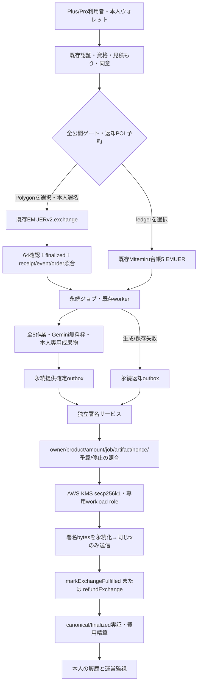

# 独立監査依頼・再現資料

2026-11-11。対象：EMUERv2、冷蔵庫くん5 EMUER決済、managed signer、返却、既存台帳との境界。
**これは監査依頼書。第三者監査は未発注・未実施。内部検証の成功と独立監査を区別する。**

## 構成と資金フロー

Polygon支払いは利用者→treasuryへ5 EMUER。コントラクトのreservedForRefundsで未提供額を拘束。生成・保存後に提供確定、失敗はoriginal buyerへ全額返却。POLはユーザーのexchange用と運営の返却/確定用が別である。ガス代は5 EMUERに含まず、ネットワーク消費分は返却対象外。アプリ内台帳経路を置換しない。

## 信頼境界・権限

| 主体 | 実権限 | 制約・未確認 |
| --- | --- | --- |
| 本人 | 登録wallet所有署名・exchange送信 | 他人/別chain/token拒否。鍵は預からない |
| 現authorizer | AUTHORIZER_ROLE、EIP712 Order承認 | REFUND/PAUSER/adminなし。新返却鍵と分離。既存secret管理は別監査対象 |
| 専用KMS operator | 予定REFUND_ROLE | 未作成・未付与。roleは**全注文**に及ぶ |
| signer service | 正規service注文の返却/提供確定だけ署名 | DB・実chain・独立停止・KeyStateを検証。オンチェーン権限の限定ではない |
| signer workload IAM | 1本ARNのDescribe/GetPublic/Sign(DIGEST) | 静的AWSキー禁止。アプリにKMS Sign権限を付けない |
| backend | 専用signer呼出・outbox・照合 | 返却鍵なし。TLS host/認証/期限固定。署名bytes保存後だけ送信 |
| treasury/admin | DEFAULT_ADMIN/AUTHORIZER/REFUND/PAUSER | 既存全体管理権限。保持・変更・本人関係は独立監査必須 |
| Firestore server IAM | private注文/job/budget/署名記録 | Admin SDKはRulesを迂回する。IAMをcollection所有制御と混同しない |
| 一般client/owner画面 | emuer_v2_*へ直接読書き不可 | Rulesの拒否試験済み。特権Console操作は別 |

用途別権限は現authorizerと新返却operatorで分ける。refund/fulfillmentは現コントラクトの同じREFUND_ROLEである。method別オンチェーン権限・サービス注文だけの権限はない。専用keyを作るだけでこの残存リスクが解消したとはしない。

## 脅威・検証・残存リスク

| ID | 脅威 | 実装/試験 | 残件・公開ゲート |
| --- | --- | --- | --- |
| R1 | 偽chain/code/proxy/元build不明 | chain137、runtime pin、immutable、ABI、EIP1967 slots | metadata完全一致未了。original input回収 |
| R2 | 他人の注文/City注文/金額のすり替え | uid/SPID/wallet/product/order/job/5 EMUERを独立検査 | server IAM/管理者侵害の外部評価 |
| R3 | 二重支払い・同tx再使用 | 共通order/job、冪等キー、原子的tx索引 | 既存台帳/claimRewardとの二重利用を監査 |
| R4 | nonce競合/応答喪失 | 永続slot/unsigned intent/署名bytes/nonce記録 | operatorを他システムと共用しない |
| R5 | reorg・未確定入金 | 64確認+finalized。POLはmin(finalized balance, latest balance) | RPCの信頼/大規模finality破壊は外部評価 |
| R6 | KMS停止後のcached signature再送 | cached返却前・送信直前にKeyState/role/停止確認 | 送信済みtxをKMS停止で取り消せない |
| R7 | 鍵侵害・global REFUND_ROLE濫用 | 固定ARN/address/chain/token/2メソッド、独立policy | **高リスク残件**。IAM排他管理＋独立監査。必要ならscope限定adapterを別承認 |
| R8 | POL不足・予算回避 | 入金finality、原子的予約、日次/月次/試験累積、25%余裕 | 未承認額は設定しない。POL購入・補充は別承認 |
| R9 | 失敗txの費用隠れ/二重精算 | status0もcanonical/finalized後に1回だけ記帳 | 新nonce/置換は自動化せずincident承認 |
| R10 | 返却済み誤表示・保存前提供 | 実イベント/残高方向/amount/order状態。成果物保存後だけ確定 | 本番返却・実KMS未検証 |
| R11 | 許諾撤回/PII/不正model出力 | 既存source再検証・本人専用保存・PII allowlist | 改変しないLab/City/AI機能との境界を確認 |
| R12 | 期限切れ・未完了ジョブ消去 | 新規停止、既払照合/返却継続、slot/予約を保持 | 2026-11-14期限以降の継続方針未承認 |

重大・高リスクが残るため、独立監査完了・本番公開可能とは判定しない。

## 再現手順（分離環境のみ）

1. 検証対象commitと全依存lockを固定。backend、contracts-v2、services/polygon-signer、tools/economy-testsでnpm ci。Node22.13以上、Java、Chromium、Firebase emulatorを使用。デプロイscriptは実行しない。
2. `npm --prefix backend test`、`npm --prefix services/polygon-signer test`、`npm --prefix contracts-v2 run test:payments`、`npm --prefix contracts-v2 run test:contract`。
3. `node --test contracts-v2/test/original-build.test.cjs`。元input取得後は `node contracts-v2/scripts/verify-original-build.cjs original-input.json runtime.hex abi.json`。exit2は不一致、exit1は入力/ビルド失敗、exit0も**offline比較**でありRPC provenance/公開承認ではない。
4. `firebase.economy-tests.json`、demo-emu-economy-stage2のみを使用。Auth9292/Firestore8892を起動して `node --test --test-concurrency=1 tools/economy-tests/*.test.cjs`。fixtureはそのdemo DBをresetするので、本番/実ブラウザセッションと混在させない。
5. ローカルEthereumはGanache内、chain137でも本番ではない。role変更/状態override/資産操作は合成トークン・合成鍵のみ。Geminiはこれら決済試験で明示的double。SDK doubleを実KMS成功としない。
6. SDK試験後、別承認の実KMS隔離環境でKeyState、workload、IAM拒否、監査、key rotation、ネットワーク断を試験。実PoS/Amoy接続・資産消費・ガスは別承認。

証拠：phase5-review/build-verification.json、chain-cost-evidence.json、phase5-release-evidence-20261111.json、PRとdeploy記録。実行log・公開画面截图・SHA256 manifestを監査packageへ添付。秘密鍵/seed/API key/実ユーザーの本文/資格情報を含めない。金融監査・nonce・署名記録の保持期間は法務決定待ち、未完了記録を30日で自動消去しない。

## 監査依頼先候補と見積もり依頼

候補：OpenZeppelin Security、Cyfrin、Quantstamp。これは候補一覧であり、契約・空き枠・見積書・正式受託の確認ではない。発注/問い合わせは未実施。Founderの明示承認がない限り外部へ送信しない。

依頼範囲：既存token source/deployed identity、global-role、backend/ledger、KMS/IAM/private ingress、outbox、資金予約・失敗費用、owner/plan、client署名、incident/rotation、回帰。提出物：重大度付き発見、再現、修正review、未解決risk、対象SHAと実環境構成。監査者・完了日・報告書hash・解決証跡をrelease gateへ記録。

費用：**未見積もり**。固定費のように金額を創作しない。上記範囲・コード量・KMS構成・再監査回数を提示し、税/上限/再検証費を含む書面見積もりをFounderが取得・承認してから発注する。独立監査費を既存KMS/開発費の承認へ含めない。
