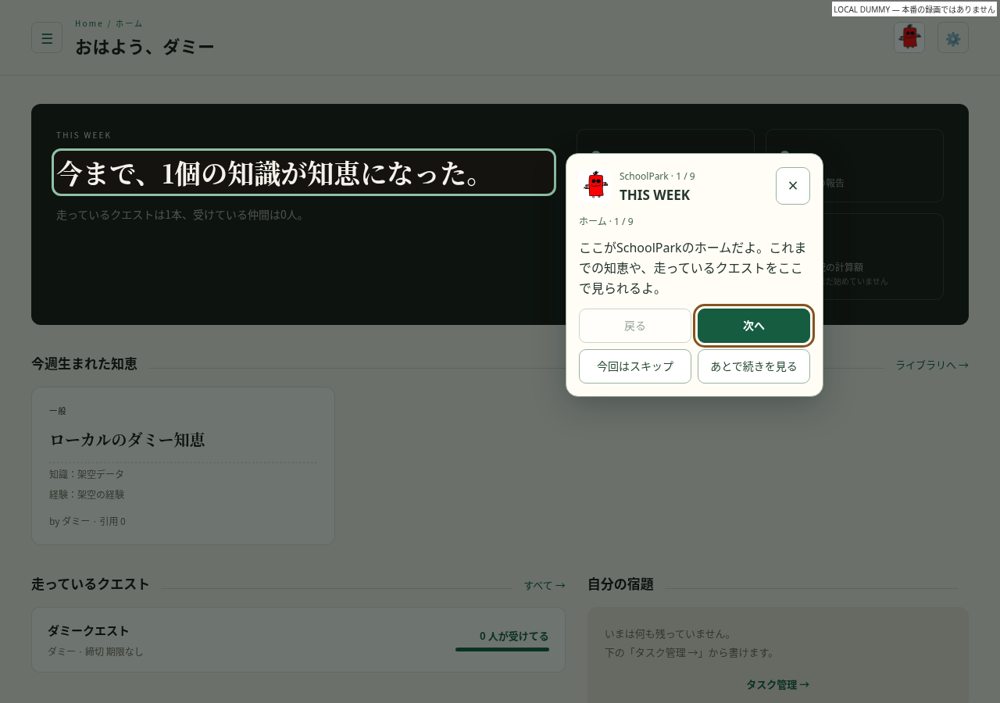
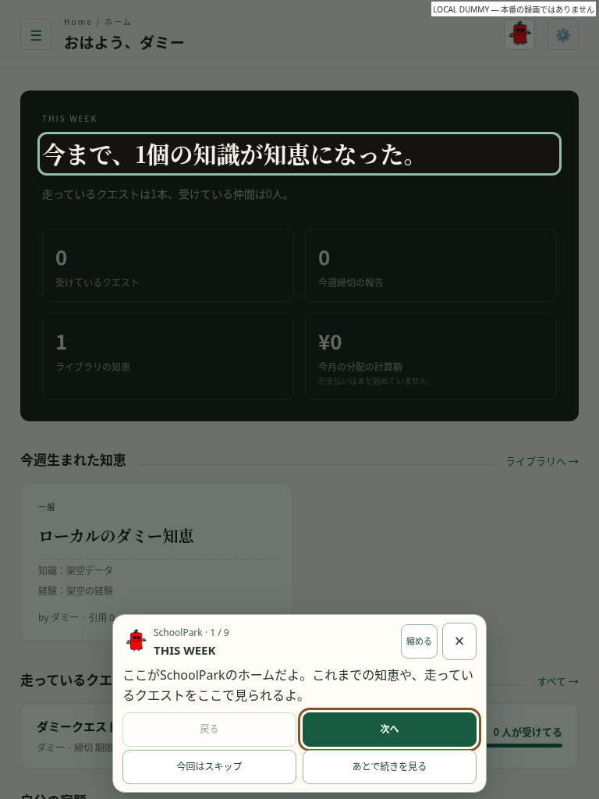
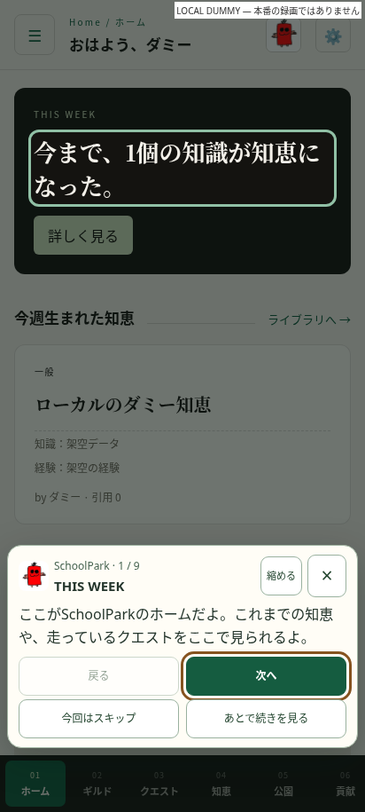
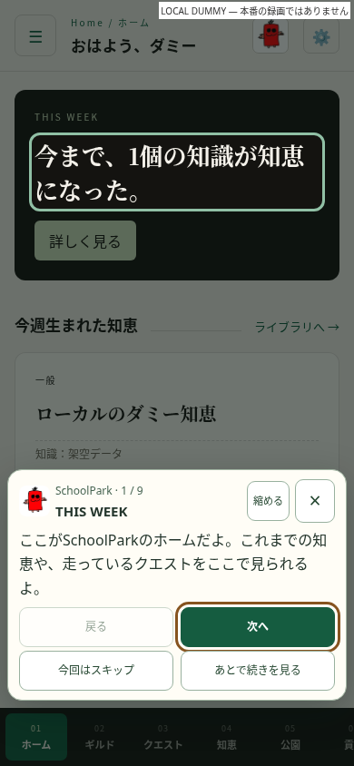
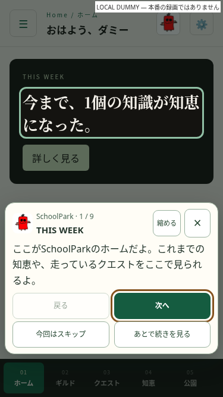
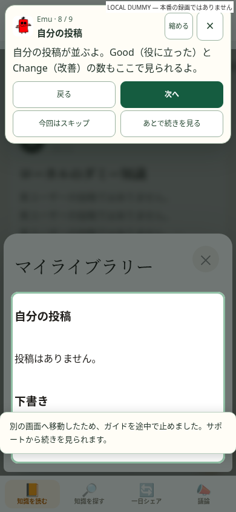
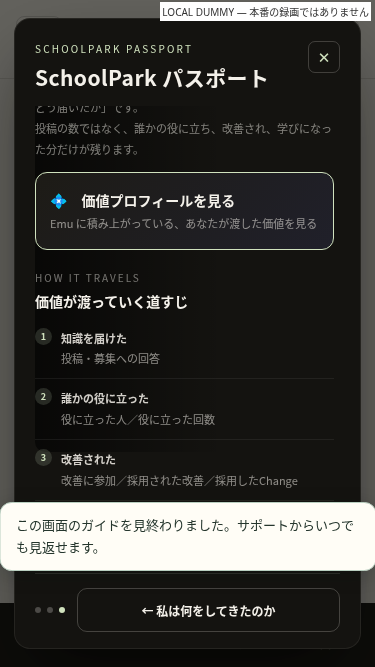

# 冷蔵庫くんガイド v2 — SchoolPark / Emu

対象は `Wertask11/emu-realtime` の SchoolPark と Emu。添付 v2 デザインに合わせた13ガイド・57ステップを実装し、以前の詳細画面など5ガイド・10ステップも手動再生用に維持する。Camellia は今回の反映対象外。

調査開始時とリリース直前の main は `4d11e28949506bf070b19330fd14b32f39d1f167`。作業ブランチは `feature/reizo-tour`。

## 変更の対応表

| 対象 | v2 の内容 | 実装 |
| --- | --- | --- |
| SchoolPark ホーム | 9ステップ、知恵・クエスト・パスポート・ギルドの入口 | `schoolpark/dao.html` の既存の閲覧リンクとナビに属性追加 |
| パスポート | 3ページ・8ステップ、ページに合わせて案内 | `index.html` の生成HTMLに属性追加、既存ページ切替のみ使用 |
| ギルド・クエスト・知恵 | 説明・絞り込み・カードと詳細の入口 | 同じ `dao.html` の実際のDOMを指す |
| 公園・貢献・treasury・CITY | 既存の閲覧領域、CITYは入口だけ | `dao.html` の属性のみ変更 |
| Emu 知識を読む | 9ステップ、投稿入口・検索・並び替え・テーマ・カード・ライブラリー・タブ | `knowledge.html` と親画面の既存の名前メニュー |
| Emu 知識を探す | 5ステップ、募集一覧・フォームの見方・やめる・Room1 | `index.html` の既存フォームと入口 |
| Emu 一日シェア | 6ステップ、みんな・今日・自分の記録へ切替 | `ichinichi.html` の既存タブ関数と見出し |
| Emu 議論 | 1ステップ、一覧の見方 | `discussion.html` の既存一覧見出し |
| 共通ガイド | 備考・16px本文・3px枠・18px間隔・小画面の縮小表示 | `tour/reizo-tour.js` / `reizo-tour.css` |
| 読み込み待ち | データ・覆い・ページめくりが終わるまで説明しない | `reizo-tour-pages.js`、受信済みフラグ専用 `reizo-tour-frame.js` |

## 動作・互換性

- 初回の自動表示は実際のデータ描画と読み込みカバーの終了後。完了・スキップ・途中のガイドは自動再生しない。別画面へ移ると途中保存し、サポートから再開できる。
- `rk-tour-v1` をそのまま使用。以前の `{version:1,tours:{...}}` は完了状態を維持し、旧ステップと意味が対応する v2 の位置へ引き継ぐ。新しい保存形式は `{tourId: "done" | "skipped" | stepIndex}`。個人情報・入力内容・投稿IDを保存しない。
- 説明を出すために呼ぶ処理はサイドバー、名前メニュー、パスポートのページ、ライブラリー、既存募集フォーム、閲覧タブだけ。実際に押した操作は元のハンドラーを一度実行した後で進む。
- 「次へ」だけで完走できる。公開・応募・回答・Good・Change・取り入れる・NFT・ウォレット連携・KYC・支払いを自動実行しない。既存募集の入力は案内から開いても消さない。
- 大きい領域で縮小したときも72pxのシートに「次へ／完了」を表示する。ユーザーによる展開を尊重し、募集フォームの「やめる／公開」の行を説明で覆わない。
- ボタンは44px以上。Esc、フォーカス復元、読み上げ用のステップ通知、reduced-motionを確認。
- 動画は SchoolPark / Emu × PC / スマホの4枠を「動画準備中」と表示。実ファイルはまだない。

## 実際のDOMに合わせた差分

- ホームの総数は累計なので、案内本文を「これまでの知恵」とした。アプリの既存文言・計算は変更しない。
- ホームはカードの見出しではなく、実際に一覧を開く「ライブラリへ」「すべて」を指す。
- PCで閉じているサイドバーはパスポートの案内時に開く。スマホのマイライブラリーは既存の名前メニューを開く。
- 長い公園の列・シェア履歴・議論一覧は既存の入口／見出しを指し、投稿フォームや全記事を枠で覆わない。
- 以前の補助5ガイドは、v2の主ガイドから詳細画面へ進んだときに別の説明が割り込まないよう手動再生にする。

## 検証

実ブラウザは Chromium。実際のアプリHTML、テンプレート、UIハンドラーを使い、認証・データだけをローカルの架空データに置換した。外部HTTPは遮断またはブラウザ内で応答するため、本番データへの書き込みはゼロ。お問い合わせ送信の回帰確認もローカル応答で行った。

| 画面幅 | 結果 |
| --- | --- |
| 1280px | 18ガイド・67ステップ完走、枠・操作・保存・チャット・サポート PASS |
| 768px | 同上 PASS |
| 412px | 同上 PASS |
| 390px | 同上 PASS |
| 375px | 同上 PASS |

- 関連する Node テスト206件 PASS（ガイド10件、既存Emu161件、年内目標35件）。
- 読み込み覆いのフェード、ホームの一部データ未着、宿題だけ読み込めない場合、ギルド・クエストの遅延・拒否・空結果・古い画面への遅延到着を375/1280pxで確認 PASS。
- 完了・スキップ・旧形式の途中状態の再生、対象欠落の2.5秒処理、スクロールで対象が画面外になっても進捗を飛ばさないこと、DOM再描画、リサイズ、Esc、保存不可時の動作 PASS。
- ネイティブHTMLのロジックとスタイルが基準mainと一致することをテストで確認。差分はガイド用属性とガイド受信フラグ用スクリプトの読込だけ。ネイティブ23スクリプトとガイドJSの構文確認、`git diff --check` PASS。静的フロントエンドにlint/buildスクリプトはない。
- パスポートの800msページめくり中に先へ進む操作、ライブラリー読込中のキャンセル、既存募集の下書き維持、関係ないフォームを開いたときのガイド中断を375/1280pxで確認 PASS。

実際の本番アカウントでのログイン・決済・Firestore書き込みは今回のテストでは実行していない。認証、Rules、スキーマ、権限、報酬、決済、API、環境変数、デプロイ設定、管理画面、既存Analytics送信処理は変更なし。ガイドはローカル開発環境で固定メタデータを `console.debug` に出すだけで、本番に新しい計測送信を追加しない。

検証で確認された今回の変更に起因するP0/P1残件はゼロ。動画の実ファイル追加とCamellia版は対象外として保留。

## 再実行

```sh
node --test tools/tour-tests/reizo-tour.test.cjs tools/emu-tests/*.test.cjs tools/year-goals-tests/*.test.cjs
python tools/tour-tests/serve.py
# 別のターミナルで
python tools/tour-tests/browser.py --output /tmp/reizo-v2-evidence
python tools/tour-tests/timing.py
python tools/tour-tests/home-ready.py
python tools/tour-tests/related.py
```

## スクリーンショット

すべて **LOCAL DUMMY（本番の録画ではない）**。実ユーザーの名前や記録は含まない。








